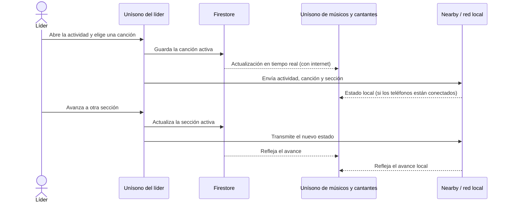
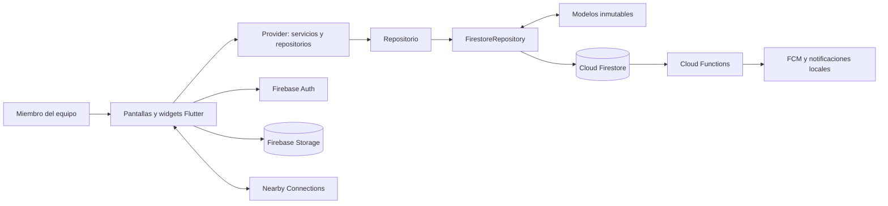
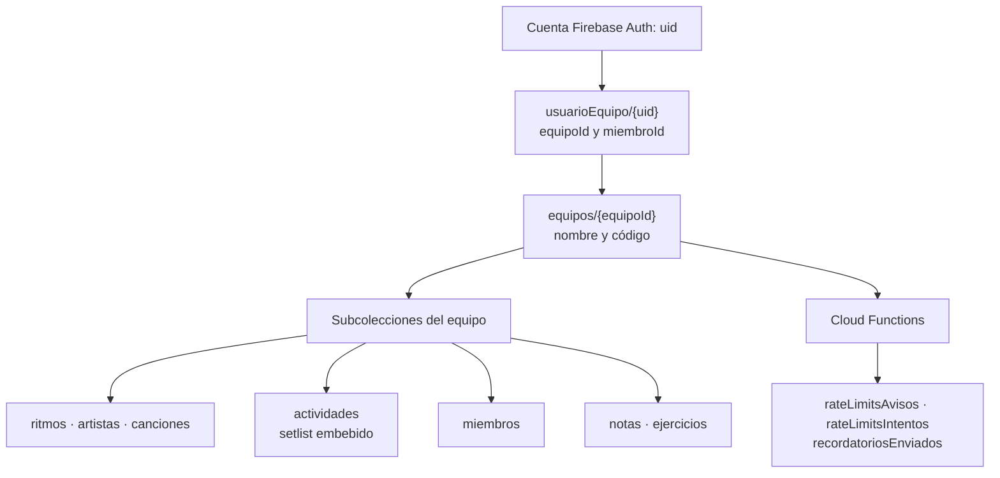
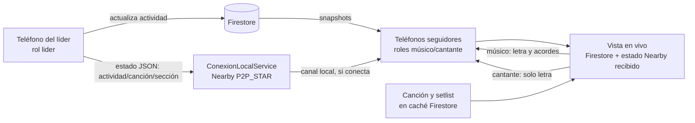
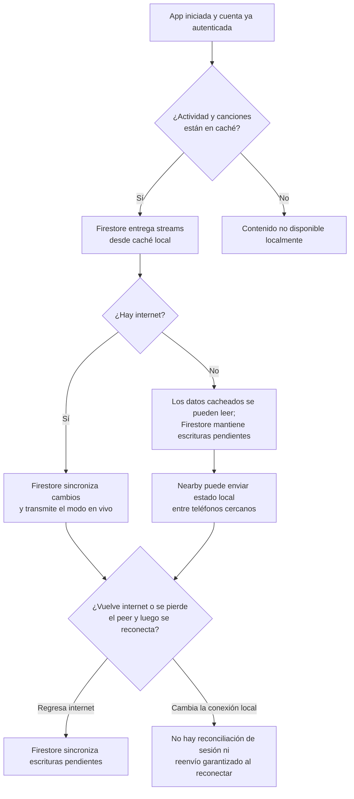
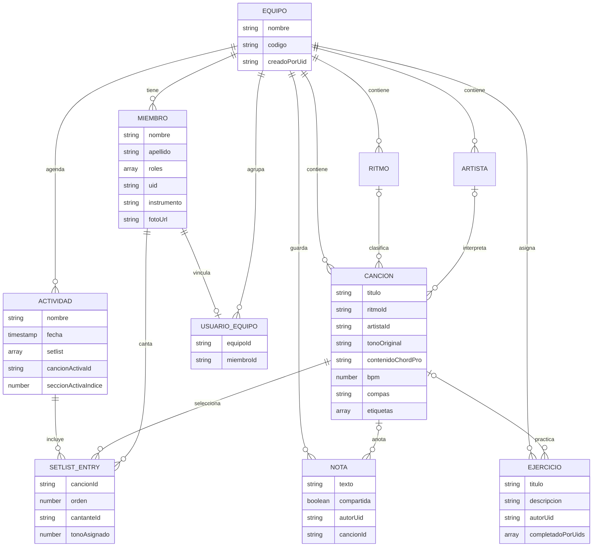

<div align="center">


# Unísono

**Cuando varias voces suenan como una sola.**

[](.github/workflows/build-debug-apk.yml)
[](#instalación-y-configuración)
[](docs/API.md)
[](LICENSE)
[](https://github.com/Lualvarad0/Unisono/actions/workflows/build-debug-apk.yml)

[Abrir la página de descarga](https://app-alabanzas.web.app) ·
[Descargar la última versión Android](https://github.com/Lualvarad0/Unisono/releases/latest) ·
[Ver incidencias abiertas](https://github.com/Lualvarad0/Unisono/issues)

<!-- TODO GIF: reemplazar por una captura grabada de la app real; ver docs/assets/README.md -->

</div>

## ¿Qué es Unísono?

Unísono es una aplicación móvil para que un equipo de alabanza organice
su repertorio y se prepare para servicios y ensayos. Guarda letras y
acordes en formato ChordPro, permite asignar canciones y tonos a una
actividad y ofrece una vista en vivo para seguir el orden y la sección
que dirige el líder.

Cada grupo tiene su propio espacio en Firebase. Una persona puede crear
un equipo o unirse a uno con un código; los datos de repertorio,
actividades y miembros quedan separados entre equipos. La aplicación
está construida con Flutter y usa Firebase como backend.

**Unísono no sustituye la coordinación del equipo ni promete que todas
las funciones trabajen sin conexión.** Los datos que ya están en caché
se pueden leer sin internet. Hay un canal de Nearby para transmitir el
modo en vivo entre teléfonos cercanos, pero el flujo completo sin
internet —incluida la conducción local-first, la reconciliación y la
recuperación automática— sigue en desarrollo (issues [#10–#14](https://github.com/Lualvarad0/Unisono/issues/10)).

### Vista rápida de un servicio



La vista en línea y el transporte local ya están conectados en el código.
Sin embargo, las acciones del líder esperan actualmente la escritura en
Firestore antes de continuar; por eso **el uso completamente offline no
está garantizado todavía**. Consulta el [estado de sincronización](docs/ARCHITECTURE.md#sincronización-y-límites-actuales)
y el [roadmap de issues](#roadmap-e-issues-abiertos).

## Funcionalidades y roles

| Funcionalidad | Quién la usa | Estado comprobado en el código |
|---|---|---|
| Cuenta con correo y contraseña; crear equipo o unirse con código | Todas las personas | ✅ Implementado con Firebase Auth y Firestore |
| Repertorio con letra, acordes, tonalidad, ritmo, artista y etiquetas | Equipo | ✅ Implementado; parser y transposición ChordPro |
| Actividades, setlists ordenados, cantante y tono por canción | Equipo | ✅ Implementado |
| Vista en vivo que muestra canción y sección activa en dispositivos del equipo | Líder, músicos y cantantes | ✅ Implementado mediante streams de Firestore cuando hay conexión |
| Lectura de datos previamente descargados sin internet | Equipo ya autenticado | ✅ Caché persistente de Firestore; depende de que el contenido esté en el dispositivo |
| Envío local de canción y sección por Nearby | Líder y seguidores cercanos | ⚠️ Integrado parcialmente; el funcionamiento offline completo y la prueba en dispositivos están pendientes, ver [#10–#14](https://github.com/Lualvarad0/Unisono/issues/10) |
| Notificaciones de actividad, setlist, asignación e integrantes; recordatorio | Equipo | ✅ Cliente y Cloud Functions implementados; requieren Firebase configurado y despliegue |
| Notas personales o compartidas y consignas de práctica | Equipo | ✅ Implementado |
| Perfil, foto y preferencias de lectura/apariencia | Cada persona | ✅ Implementado |
| Favoritos personales, búsqueda avanzada, filtros/duplicación de actividades | Equipo | 📅 Planeado en [#5–#9](https://github.com/Lualvarad0/Unisono/issues/5) |

### Roles que reconoce el modelo

- **Líder:** puede conducir el modo en vivo desde la interfaz, además de
  participar como músico o cantante si también tiene esos roles.
- **Músico:** puede ver letra y acordes en la vista de escenario; puede
  ocultar los acordes con su preferencia de apariencia.
- **Cantante:** ve la letra sin acordes en la vista de escenario.

Los roles son una lista en el perfil `Miembro`, así que una persona puede
tener más de uno. La interfaz limita algunas acciones por rol, pero las
reglas actuales de Firestore permiten a cualquier integrante autenticado
del equipo leer y escribir `actividades`; el rol de líder **no** es una
frontera de autorización del servidor. Este aspecto está señalado en
la épica de sincronización [#10](https://github.com/Lualvarad0/Unisono/issues/10).

## Arquitectura

El proyecto organiza `lib/` por capas técnicas: modelos, repositorios,
servicios, pantallas y widgets. `Provider` expone dependencias y estado;
los repositorios esconden el acceso a Firestore tras `Repositorio<T>`.
El detalle, las decisiones y las limitaciones de cada flujo están en
[docs/ARCHITECTURE.md](docs/ARCHITECTURE.md).

### Componentes de la aplicación



### Firestore y separación por equipo



### Líder y seguidores en la sesión



### En línea, sin internet y reconexión



**Límite importante:** Firestore conserva caché y sincroniza escrituras
pendientes al recuperar internet. El canal Nearby transmite solamente
`actividadId`, `cancionActivaId` y `seccionActivaIndice`; no envía letras
ni setlists. El código todavía no versiona mensajes, no hace reconciliación
de autoridad y no garantiza que un seguidor que se reconecte reciba el
último estado. Esos trabajos están abiertos en [#11](https://github.com/Lualvarad0/Unisono/issues/11),
[#12](https://github.com/Lualvarad0/Unisono/issues/12) y
[#13](https://github.com/Lualvarad0/Unisono/issues/13).

## Modelo de datos

Los documentos de contenido pertenecen a `equipos/{equipoId}`. El ID de
cada documento lo administra Firestore y no se repite en los campos del
documento. `SetlistEntry` se guarda dentro del arreglo `setlist` de una
actividad, no en una colección independiente.



Ejemplos abreviados de documentos Firestore:

En los ejemplos, la cadena `"Timestamp de Firestore"` es solo un
marcador legible; el valor real se guarda como `Timestamp`.

```json
{
  "coleccion": "equipos/{equipoId}",
  "documento": {
    "nombre": "Equipo de alabanza",
    "codigo": "AB2CD3",
    "creadoPorUid": "uid-ejemplo",
    "creadoEn": "Timestamp de Firestore"
  }
}
```

```json
{
  "coleccion": "equipos/{equipoId}/canciones/{cancionId}",
  "documento": {
    "titulo": "Canto de ejemplo",
    "ritmoId": "ritmo-id",
    "artistaId": null,
    "tonoOriginal": "G",
    "contenidoChordPro": "{start_of_chorus: Coro}\n[G]Letra [D]de ejemplo\n{end_of_chorus}",
    "bpm": 76,
    "compas": "4/4",
    "etiquetas": ["adoración"],
    "creadaEn": "Timestamp de Firestore"
  }
}
```

```json
{
  "coleccion": "equipos/{equipoId}/actividades/{actividadId}",
  "documento": {
    "nombre": "Servicio del domingo",
    "fecha": "Timestamp de Firestore",
    "setlist": [
      {
        "cancionId": "cancion-id",
        "orden": 0,
        "cantanteId": "miembro-id",
        "tonoAsignado": 2
      }
    ],
    "cancionActivaId": null,
    "seccionActivaIndice": 0
  }
}
```

```json
{
  "coleccion": "equipos/{equipoId}/miembros/{miembroId}",
  "documento": {
    "nombre": "Ana",
    "apellido": "Ejemplo",
    "roles": ["cantante", "musico"],
    "uid": "uid-ejemplo",
    "instrumento": "Guitarra",
    "nivelInstrumento": "intermedio",
    "fotoUrl": null,
    "fcmToken": null
  }
}
```

La colección raíz `usuarioEquipo/{uid}` relaciona una cuenta con su
`equipoId` y `miembroId`. Las colecciones internas de control de las
Cloud Functions (`rateLimitsAvisos`, `rateLimitsIntentos` y
`recordatoriosEnviados`) no son datos editables por el cliente. Para
campos completos y reglas, consulta [docs/API.md](docs/API.md) y
[docs/SEGURIDAD.md](docs/SEGURIDAD.md).

## Estructura del repositorio

```mermaid
flowchart TD
    Root["Unísono · raíz del repositorio"]
    Root --> Android["android/ · proyecto nativo Android"]
    Root --> IOS["ios/ · proyecto nativo iOS"]
    Root --> Assets["assets/icon/ · iconos"]
    Root --> Docs["docs/ · documentación"]
    Root --> Functions["functions/ · Cloud Functions"]
    Root --> Landing["landing/ · React y Vite"]
    Root --> Lib["lib/ · aplicación Flutter"]
    Root --> Packages["packages/ · fork local de Nearby"]
    Root --> Tests["test/ · pruebas Dart y Flutter"]
    Root --> FirestoreRules["firestore.rules"]
    Root --> StorageRules["storage.rules"]
    Root --> Pubspec["pubspec.yaml y pubspec.lock"]
    Docs --> DocsAssets["assets/ · plan de capturas"]
    Docs --> API["API.md · datos y Cloud Functions"]
    Docs --> Architecture["ARCHITECTURE.md · arquitectura"]
    Docs --> Style["ESTILO_DE_CODIGO.md · convenciones"]
    Docs --> Security["SEGURIDAD.md · reglas y límites"]
    Lib --> Core["core/ · Firestore, temas y utilidades"]
    Lib --> Models["models/ · dominio y ChordPro"]
    Lib --> Repositories["repositories/ · datos del equipo"]
    Lib --> Screens["screens/ · acceso, contenido y actividades"]
    Lib --> Services["services/ · Firebase, ChordPro y Nearby"]
    Lib --> Widgets["widgets/ · componentes reutilizables"]
```



## Instalación y configuración

### Versiones verificadas en el repositorio

| Herramienta | Versión comprobada |
|---|---|
| Flutter estable | `3.47.2`, fijada en los workflows de GitHub Actions |
| Dart | `pubspec.yaml` acepta `>=3.3.0 <4.0.0`; el lockfile actual declara `>=3.12.0` |
| Java para Android en CI | Temurin `17` |
| Node.js para Cloud Functions | `24`, declarado en `functions/package.json` |
| Versión de la app | `0.1.0+1`, declarada en `pubspec.yaml` |

Las versiones exactas de paquetes Dart se resuelven en
[`pubspec.lock`](pubspec.lock); `pubspec.yaml` declara rangos. Algunos
paquetes principales, según el lockfile actual, son `firebase_core
3.15.2`, `cloud_firestore 5.6.12`, `firebase_auth 5.7.0`,
`firebase_storage 12.4.10`, `provider 6.1.5+1` y
`flutter_nearby_connections_plus 1.2.2` (este último se resuelve al fork
local en `packages/`).

### Preparar las herramientas

Instala Flutter `3.47.2` estable y verifica que el SDK de Android esté
configurado:

```bash
flutter --version
flutter doctor
```

Para compilar Android se necesita Android Studio o el SDK de Android
equivalente y un dispositivo/emulador configurado. Para compilar o
ejecutar iOS se necesita macOS con Xcode instalado; el proyecto contiene
los archivos iOS, pero no se verificó aquí la ejecución en un iPhone
real. Las funciones de red local se deben probar en teléfonos reales, no
en un emulador.

### Clonar y resolver dependencias

```bash
git clone https://github.com/Lualvarad0/Unisono.git
cd Unisono
flutter pub get
```

### Configurar tu propio proyecto Firebase

Cada instalación debe apuntar a un proyecto Firebase propio. No se
incluyen credenciales ni archivos de configuración Firebase en el repo:
`lib/firebase_options.dart`, los archivos nativos de Firebase,
`firebase.json` y `.firebaserc` están excluidos por `.gitignore`.

1. Crea un proyecto Firebase y registra las apps Android
   (`com.appalabanzas.app_alabanzas`) y/o iOS.
2. Instala y autentica Firebase CLI y FlutterFire CLI siguiendo sus
   instrucciones oficiales. Las versiones de esas CLI no están fijadas
   por este repositorio.
3. Desde la raíz del proyecto configura las plataformas que vas a usar:

   ```bash
   flutterfire configure
   ```

   Conserva los archivos generados localmente y no los agregues al repo
   público. En Android se necesita además `android/app/google-services.json`;
   en iOS, `ios/Runner/GoogleService-Info.plist`.
4. En Firebase Console habilita **Authentication → Correo electrónico y
   contraseña**, crea **Cloud Firestore** y habilita **Firebase
   Storage**. Cloud Messaging se utiliza para notificaciones.
5. Si vas a desplegar reglas y funciones, ejecuta `firebase init` desde
   la raíz y selecciona Firestore, Functions y Storage en el asistente.
   Configura las reglas como `firestore.rules` y `storage.rules`, y la
   carpeta existente `functions/`; vincula tu proyecto
   (`firebase use --add`) y confirma que la configuración apunte a
   `firestore.rules`, `storage.rules` y `functions/`. Este repo no
   contiene `firebase.json` ni `.firebaserc`; ambos archivos locales
   están ignorados. Después puedes desplegar con:

   ```bash
   firebase deploy --only firestore:rules,storage,functions
   ```

   Si necesitas instalar las dependencias de las funciones manualmente,
   usa el lockfile incluido:

   ```bash
   cd functions
   npm ci
   cd ..
   ```

   `functions/package.json` requiere Node.js `24`. El despliegue de
   Cloud Functions puede requerir un plan de facturación de Firebase/Google
   Cloud; confirma requisitos y costos en la consola antes de habilitarlo.

### Ejecutar en Android o iOS

Con Firebase configurado y el dispositivo conectado:

```bash
flutter devices
flutter analyze
flutter test
flutter run -d DEVICE_ID
```

En iOS, ejecuta el comando desde macOS con Xcode y la app iOS registrada
en tu proyecto Firebase. Para ejecutar el sitio web de descarga local,
consulta [`landing/README.md`](landing/README.md); esa carpeta es un
proyecto aparte y no es la aplicación móvil.

## Probar sincronización local con 2 o más teléfonos

**Estado:** la integración Nearby está en la app, pero las tareas de
conducción local-first, estado de conexión, reconexión y prueba real aún
están abiertas en [#10–#14](https://github.com/Lualvarad0/Unisono/issues/10).
La prueba sirve para observar el comportamiento actual y aportar
validación; no presupone que los criterios futuros ya estén resueltos.

1. Usa dos o más teléfonos Android reales, instala la misma compilación
   y configura cada teléfono con el mismo proyecto Firebase.
2. Con internet disponible, inicia sesión en cada uno, vincúlalos al
   mismo equipo y abre una actividad. Revisa que la actividad, su setlist
   y las canciones necesarias se hayan cargado en cada teléfono.
3. En los teléfonos, acepta los permisos de Bluetooth, dispositivos
   cercanos y ubicación que solicite el sistema. La app inicia el
   descubrimiento local al entrar en la navegación principal; el miembro
   con rol `lider` anuncia el teléfono y los demás buscan el líder.
4. Mantén Bluetooth y Wi-Fi activados. Quita el acceso a internet sin
   apagar las radios locales (por ejemplo, desactiva datos móviles y usa
   una red local sin salida a internet, o modo avión y vuelve a activar
   Bluetooth/Wi-Fi si el fabricante lo permite).
5. En el teléfono del líder, abre **En vivo**, elige una canción y cambia
   de sección. Observa si los seguidores muestran los cambios. Como parte
   de la implementación actual el líder espera a la escritura Firestore,
   así que la operación puede no avanzar sin internet: anota el resultado,
   no lo interpretes como una prueba aprobada.
6. Recupera internet y observa si Firestore sincroniza las escrituras
   pendientes. La recuperación de sesión Nearby no está garantizada por
   el código actual.

### Solución de problemas

| Síntoma | Qué revisar |
|---|---|
| Error al iniciar o pantalla de reintento | Que `lib/firebase_options.dart` exista localmente y corresponda al proyecto; conexión a internet para el primer inicio; configuración de Firebase de la plataforma. |
| Android falla al compilar o inicializar Firebase | Que exista `android/app/google-services.json` y que la app registrada use `com.appalabanzas.app_alabanzas`. |
| iOS no compila o no inicia Firebase | macOS/Xcode, app iOS registrada y `ios/Runner/GoogleService-Info.plist`; verifica también permisos y red local. |
| No aparecen equipo, repertorio o actividad | Comprueba que ambas cuentas pertenezcan al mismo `equipoId`, que Firestore esté habilitado y que cada teléfono tenga internet al menos durante la carga inicial. |
| No llegan notificaciones | Revisa que las Cloud Functions estén desplegadas, permisos de notificación del sistema y token FCM; el cliente por sí solo no genera los avisos del servidor. |
| Los teléfonos no se descubren | Prueba en dispositivos reales, confirma permisos Bluetooth/ubicación/dispositivos cercanos, mantén Wi-Fi y Bluetooth encendidos y acerca los teléfonos. Nearby no se valida con emulador. |
| El seguidor no refleja la sección al instante | La tarea de transmisión local-first y reenvío al reconectar está abierta en [#12](https://github.com/Lualvarad0/Unisono/issues/12) y [#13](https://github.com/Lualvarad0/Unisono/issues/13); registra modelo, sistema operativo y si había internet. |

## Pruebas y automatización

Pruebas que existen actualmente:

- `test/chordpro/acorde_test.dart`: acordes y transposición.
- `test/chordpro/chordpro_parser_test.dart`: secciones, letra, directivas,
  tonos y round-trip ChordPro.
- `test/chordpro/editor_simple_test.dart`: conversión y edición del
  formato simple.
- `test/widget_test.dart`: smoke test de un `MaterialApp` con texto
  placeholder; no inicia la app completa ni conecta a Firebase.

No hay pruebas de integración de Firebase, reglas, notificaciones ni
Nearby; tampoco pruebas de sincronización multi-dispositivo
automatizadas.

GitHub Actions está en `.github/workflows/`:

- `build-debug-apk.yml` se ejecuta en cada push a `main` o manualmente;
  usa Flutter `3.47.2`, Java `17`, corre `flutter analyze` y
  `flutter test`, y genera un APK debug como artifact.
- `release-apk.yml` se ejecuta al subir un tag `v*` o manualmente; corre
  análisis y pruebas y publica un APK Android en GitHub Releases. Requiere
  los secretos configurados que se describen en
  [docs/SEGURIDAD.md](docs/SEGURIDAD.md).

## Roadmap e issues abiertos

Estado consultado en GitHub al preparar esta documentación. La lista
viva y el estado más reciente están en
[Issues abiertos](https://github.com/Lualvarad0/Unisono/issues?q=is%3Aissue+is%3Aopen).
Los enlaces evitan duplicar criterios de aceptación que pueden cambiar:

| Issue abierto | Tema | Situación observada en el código |
|---|---|---|
| [#10 — Épica: modo en vivo resiliente sin internet](https://github.com/Lualvarad0/Unisono/issues/10) | Conducción offline del líder, reconciliación, recuperación y pruebas reales | La épica describe trabajo pendiente; la implementación actual de Nearby no cumple aún el flujo local-first completo |
| [#11 — Protocolo versionado](https://github.com/Lualvarad0/Unisono/issues/11) | Sesión, secuencia monotónica, tipo de evento y validación de mensajes | El estado actual solo contiene actividad, canción y sección |
| [#12 — Conducción local-first y reconciliación](https://github.com/Lualvarad0/Unisono/issues/12) | No bloquear cambios por Firestore; definir checkpoint autoritativo | El líder espera a `Repositorio.actualizar` antes de transmitir localmente |
| [#13 — Recuperar seguidores y mostrar sincronización](https://github.com/Lualvarad0/Unisono/issues/13) | Estado de conexión, snapshot actual al reconectar y prueba offline | El código no garantiza reenvío al reconectar ni presenta estado de seguimiento |
| [#14 — Prueba en dispositivos y documentación offline](https://github.com/Lualvarad0/Unisono/issues/14) | Validar en teléfonos y documentar el resultado | La prueba multi-dispositivo sigue pendiente |
| [#5 — Ordenar alabanzas recientes](https://github.com/Lualvarad0/Unisono/issues/5) | Orden por fecha de carga | Planeado |
| [#6 — Buscar por artista y etiquetas](https://github.com/Lualvarad0/Unisono/issues/6) | Búsqueda del repertorio | Planeado |
| [#7 — Filtrar actividades](https://github.com/Lualvarad0/Unisono/issues/7) | Actividades próximas y anteriores | Planeado |
| [#8 — Favoritas personales](https://github.com/Lualvarad0/Unisono/issues/8) | Favoritos por usuario | Planeado |
| [#9 — Duplicar actividad](https://github.com/Lualvarad0/Unisono/issues/9) | Crear actividad reutilizando setlist | Planeado |

Los issues [#11–#14](https://github.com/Lualvarad0/Unisono/issues/11)
son subtareas de la épica #10; no son funcionalidades que deban
considerarse terminadas por aparecer en la app.

## Contribuir

Lee [`CONTRIBUTING.md`](CONTRIBUTING.md) para el flujo de desarrollo,
validaciones y propuesta de cambios. Las convenciones actuales de nombres,
modelos y capas están en
[`docs/ESTILO_DE_CODIGO.md`](docs/ESTILO_DE_CODIGO.md).

## Documentación adicional

| Documento | Contenido |
|---|---|
| [docs/API.md](docs/API.md) | Colecciones Firestore, repositorios, ChordPro, autenticación y Cloud Functions |
| [docs/ARCHITECTURE.md](docs/ARCHITECTURE.md) | Providers, capas, decisiones y límites de sincronización |
| [docs/SEGURIDAD.md](docs/SEGURIDAD.md) | Reglas de Firestore/Storage, secretos y límites de seguridad |
| [docs/ESTILO_DE_CODIGO.md](docs/ESTILO_DE_CODIGO.md) | Convenciones observadas en el código |
| [docs/assets/README.md](docs/assets/README.md) | Lista y plan de capturas/GIFs pendientes |

## Licencia y créditos

El código de Unísono se distribuye bajo la licencia [MIT](LICENSE).
El paquete local `packages/flutter_nearby_connections_plus/` conserva la
licencia BSD de 2 cláusulas del paquete original y sus modificaciones;
consulta su archivo [LICENSE](packages/flutter_nearby_connections_plus/LICENSE).

Desarrollado por [Cornerstone Develop](https://www.alvarado-dev.com/).
