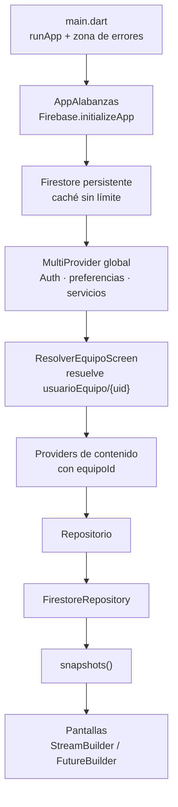
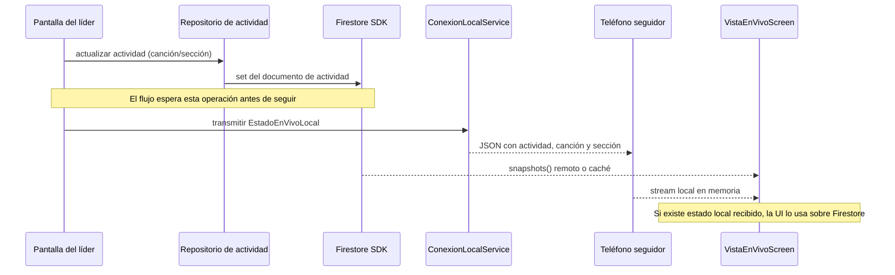
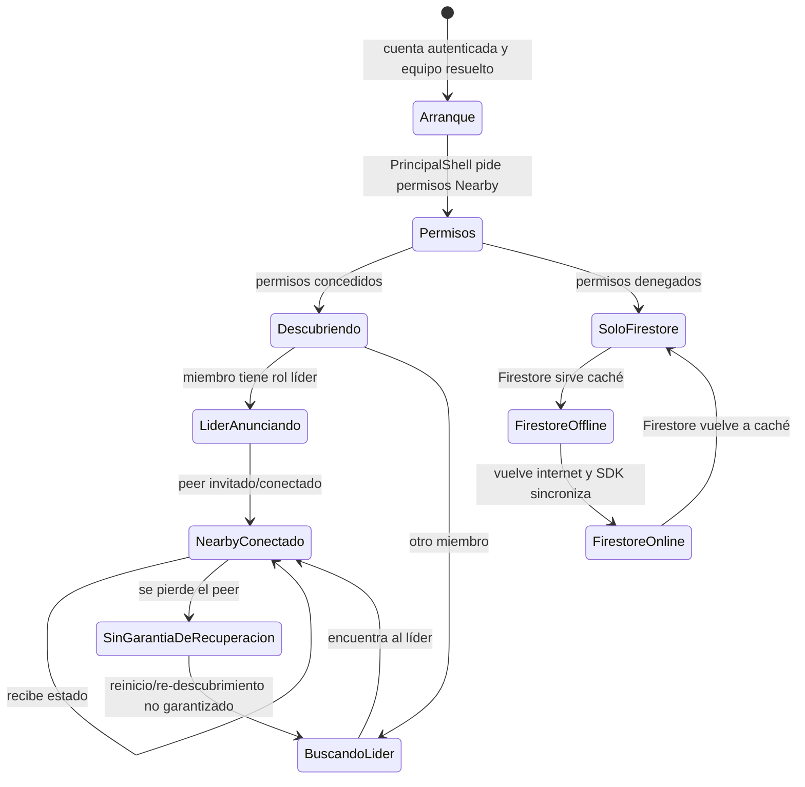

# Arquitectura actual de Unísono

Este documento describe lo que existe hoy en el código, no el diseño
futuro de la épica de sincronización offline. Para colecciones y contratos
de Firestore, consulta [API.md](API.md); para reglas de acceso y secretos,
consulta [SEGURIDAD.md](SEGURIDAD.md).

## Capas y responsabilidades

La app usa una estructura **layer-first**: `lib/` agrupa por capa
técnica y contiene subcarpetas de dominio cuando ayudan a ordenar muchos
archivos.

| Capa | Ubicación | Responsabilidad |
|---|---|---|
| Arranque y composición | `lib/main.dart`, `lib/app.dart` | Inicializa Flutter/Firebase, carga preferencias y registra providers. |
| Modelos | `lib/models/` | Representan equipos, miembros, canciones, actividades, setlists y otros datos; los modelos de dominio usan objetos tipados y conversores de Firestore. |
| Contrato de datos | `lib/core/firestore/repositorio.dart` | Define `Repositorio<T>` con streams y operaciones de lectura/escritura. |
| Implementación Firestore | `lib/core/firestore/firestore_repository.dart`, `lib/repositories/` | `FirestoreRepository<T>` implementa el contrato y repositorios concretos apuntan a colecciones de un equipo. |
| Servicios | `lib/services/` | Encapsulan Auth, preferencias, fotos, notificaciones, conectividad y transporte Nearby. |
| Interfaz | `lib/screens/`, `lib/widgets/` | Pantallas y componentes; los streams de datos se presentan con `StreamBuilder` y otros builders de Flutter. |
| Backend | `functions/`, `firestore.rules`, `storage.rules` | Cloud Functions para búsqueda/notificaciones y reglas de autorización de Firestore/Storage. |

### Provider y ciclo de vida

`AppAlabanzas` inicializa Firebase y configura Firestore con persistencia
offline y caché sin límite de tamaño. Luego `MultiProvider` registra
dependencias que no dependen de un equipo: autenticación, preferencias,
foto, conectividad, Nearby, búsqueda de equipo y vínculo cuenta-equipo.

`PreferenciasService` es el provider `ChangeNotifierProvider`; mantiene
opciones locales del dispositivo, como tema, tamaño de texto, acordes y
pantalla encendida. Los otros servicios y repositorios se registran como
`Provider` y exponen sus operaciones o streams; la mayoría del estado de
contenido se observa mediante streams de Firestore en las pantallas, no
mediante un store global con eventos.

Cuando `ResolverEquipoScreen` resuelve el equipo, crea los providers de
contenido para ese `equipoId`: repertorio, actividades, miembros, notas
y ejercicios. Esta separación evita construir un repositorio de equipo
antes de saber cuál le corresponde a la cuenta.



### Decisiones técnicas observadas

- **Provider:** se usa por simplicidad y baja carga conceptual para un
  proyecto mantenido por voluntariado. No hay Riverpod ni BLoC en la
  configuración actual.
- **Repositorio tipado:** pantallas y providers dependen de
  `Repositorio<T>`, no de la implementación concreta. Hoy
  `FirestoreRepository<T>` es la implementación real.
- **Firestore como fuente de datos remota:** los repositorios construyen
  referencias por equipo y observan `snapshots()`. La caché offline es
  la persistencia local del SDK; no hay una base SQLite/Isar propia.
- **ChordPro como texto:** `ChordProParser` y el editor viven en
  `services/chordpro/`; esa lógica se puede probar sin Firebase.
- **Preferencias en el teléfono:** apariencia y opciones de lectura usan
  `shared_preferences`, no se sincronizan entre integrantes.
- **Nearby como transporte de estado, no de contenido:** el servicio
  local envía JSON con ID de actividad, ID de canción y número de
  sección; no transmite canciones, setlists ni letras.

## Datos y Firebase

Cada equipo es el límite de acceso de los datos compartidos:

```text
equipos/{equipoId}
  ├── ritmos/{id}
  ├── artistas/{id}
  ├── canciones/{id}
  ├── actividades/{id}
  ├── miembros/{miembroId}
  ├── notas/{id}
  └── ejercicios/{id}

usuarioEquipo/{uid}
```

El documento `usuarioEquipo/{uid}` relaciona la cuenta autenticada con
un equipo y un miembro. `coleccionDeEquipo(equipoId, nombre)` centraliza
las referencias a subcolecciones de equipo. Las reglas explícitas están
en [`firestore.rules`](../firestore.rules) y
[`storage.rules`](../storage.rules).

Cloud Functions implementa una llamada callable para buscar un equipo
por código y cuatro funciones de eventos/programación relacionadas con
modo en vivo, setlists, incorporación de miembros y recordatorios. Las
reglas, las colecciones y las notificaciones están descritas con más
detalle en [API.md](API.md).

## Sincronización y límites actuales

### Contenido y operaciones Firestore

Firestore se configura con persistencia activa. Las consultas
observables pueden entregar datos desde la caché cuando el teléfono no
tiene conexión, si esos documentos ya se descargaron. Las escrituras
locales se gestionan según el comportamiento de Firestore y se pueden
sincronizar al recuperar internet. Esto no implica que Auth, Storage,
Cloud Functions o la carga inicial funcionen sin red.

`ConectividadService.watchEnLinea()` observa los metadatos de un stream
pequeño de Firestore (`ritmos`) y determina si la última respuesta vino
del servidor o de la caché. No detecta cualquier cambio físico de Wi-Fi
instantáneamente; esa distinción está explicada en el propio servicio.

### Modo en vivo por internet y red local

El modo en vivo usa dos rutas:

1. El líder actualiza `Actividad.cancionActivaId` y
   `seccionActivaIndice` en Firestore. Otros miembros observan el
   documento con streams y siguen la sección activa.
2. `ConexionLocalService` usa Nearby `P2P_STAR`: el líder anuncia y los
   demás teléfonos buscan/invitan al peer detectado. Los estados
   recibidos se guardan en memoria y la UI los usa por encima del estado
   Firestore disponible para esa actividad.



La integración no equivale todavía a una sesión offline robusta:

- `EstadoEnVivoLocal` no contiene ID de sesión, secuencia ni tipo de
  evento versionado.
- Las acciones del líder esperan a que `Repositorio.actualizar` termine
  antes de transmitir por Nearby. Sin internet, el `Future` de Firestore
  puede permanecer pendiente; la pantalla no tiene garantizado un
  avance local-first.
- El servicio conserva el último estado recibido en memoria, pero no
  garantiza que retransmita un snapshot cuando un peer se reconecta.
- No hay UI de estado desconectado/reconectando ni una conciliación
  explícita entre un estado local y otro remoto atrasado.
- La pantalla del seguidor depende de tener actividad, setlist y canción
  localmente disponibles. Nearby no los descarga ni los envía.
- El servicio se inicia en `PrincipalShellScreen` tras resolver el
  miembro y pedir permisos. Debe haber radios cercanas disponibles; el
  flujo no se valida mediante emulador.
- Las reglas Firestore dejan a cualquier integrante autenticado del
  equipo escribir actividades. El rol de líder se aplica en partes de
  la interfaz, no como permiso de servidor para esas escrituras.

### Estados de conexión



La recuperación de peer, el indicador de sincronización y la política
local-first/reconciliación pertenecen a los issues abiertos [#11–#14](https://github.com/Lualvarad0/Unisono/issues/11).
La épica completa es [#10](https://github.com/Lualvarad0/Unisono/issues/10).

### Permisos de red local

`permisos_sync_local.dart` solicita permisos Bluetooth (scan, advertise
y connect) y ubicación en tiempo de ejecución. El proyecto declara
descripciones de red local/Bluetooth y un servicio Bonjour para iOS en
`ios/Runner/Info.plist`. La matriz de permisos y comportamiento real
puede variar por versión del sistema y dispositivo; validar iOS en un
dispositivo físico continúa pendiente.

## Seguridad y configuración

No hay configuración Firebase compartida en el repositorio. Los archivos
locales ignorados son `lib/firebase_options.dart`,
`android/app/google-services.json`,
`ios/Runner/GoogleService-Info.plist`, `firebase.json` y `.firebaserc`.
Configura un proyecto Firebase propio y nunca publiques archivos de
credenciales ni secretos de firma.

La autenticación es Firebase Auth por correo y contraseña. Las reglas
Firestore aíslan subcolecciones por equipo y la callable
`buscarEquipoPorCodigo` evita listar la colección completa de equipos.
Revisa [SEGURIDAD.md](SEGURIDAD.md) para hallazgos y limitaciones
conocidas, incluida la autorización de escrituras de actividad por
cualquier miembro autenticado.

## Pruebas y estado de validación

Las pruebas Dart/Flutter actuales están en `test/`; cubren acordes,
parser ChordPro, editor simple y un widget placeholder. No hay tests de
Firebase, reglas, Cloud Functions ni sincronización Nearby automatizados.
Los workflows de CI ejecutan `flutter analyze` y `flutter test`; la
prueba en teléfonos reales está en el alcance del issue
[#14](https://github.com/Lualvarad0/Unisono/issues/14).
